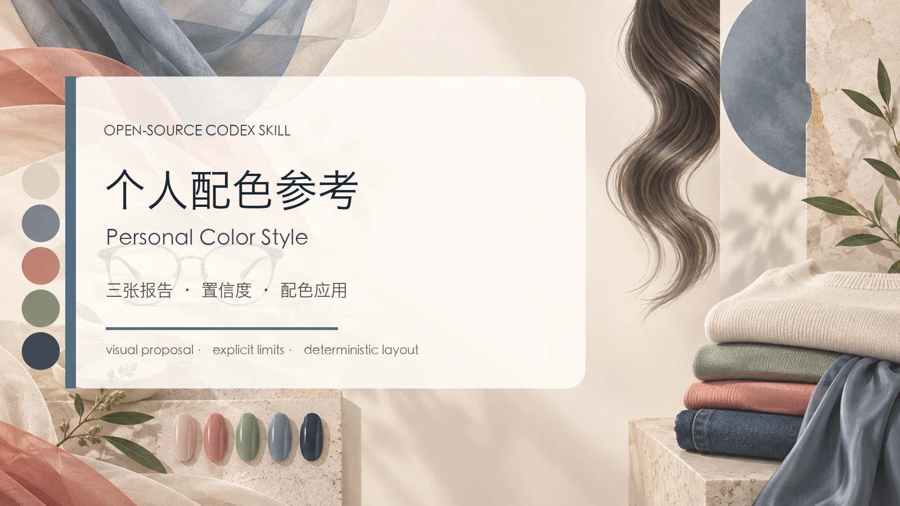

# Personal Color Style

An Agent Skill that turns an authorized portrait into three structured personal-color and styling report images with explicit photo-quality limits, confidence, and privacy boundaries.

The workflow separates visual generation from deterministic typography. It analyzes the supplied photograph as a styling reference, prepares case-specific palettes and recommendations, generates identity-consistent visual variants, and uses the bundled Pillow renderer for exact Chinese layout.



## Capabilities

- Produces three separate 1800 × 2400 PNG cards: overview, draping and outfits, and makeup, hair, and accessories.
- Distinguishes visible observations, styling hypotheses, and user-provided facts.
- Supports a primary seasonal direction plus an alternative when the photograph is ambiguous.
- Keeps one palette logic and confidence level across all three cards.
- Reuses the exact portrait crop for draping comparisons so only the surrounding color changes.
- Rejects incomplete assets, unsafe paths, unreadable CJK fonts, output collisions, and layout overflow.
- Keeps portraits, generated people, report manifests, and personal fields outside the repository.

This Skill provides photograph-based styling guidance. It does not perform laboratory color measurement, medical or dermatological assessment, attractiveness scoring, or purchasing guarantees.

## Install

Clone the repository into the Codex Skills directory:

```bash
git clone https://github.com/yiten5885-a11y/personal-color-style.git \
  ~/.codex/skills/personal-color-style
```

Pillow is required for deterministic report rendering.

## Invoke

Attach a portrait that you are authorized to use, then invoke the Skill:

```text
使用 $personal-color-style，根据我上传的人像生成三张个人色彩与形象应用报告。
先检查照片质量；证据不足时给出候选方向和置信度，不强行确定唯一季型。
试色对照必须锁定同一张人像，只改变围布颜色。
```

The standard deliverables are:

```text
01-color-style-overview.png
02-draping-and-outfits.png
03-makeup-hair-details.png
```

## Rendering workflow

Prepare a manifest that follows `references/report-contract.md`, then run:

```bash
python3 scripts/validate_manifest.py report.json --mode final
python3 scripts/render_report.py report.json --output-dir output/personal-color-series
```

To generate a synthetic fixture for local engineering checks:

```bash
python3 scripts/make_demo.py work/demo
python3 scripts/render_report.py work/demo/report.json --output-dir output/demo
```

Synthetic fixtures verify the renderer and package invariants. They do not prove color-analysis accuracy or identity preservation on a real portrait.

## Validate the package

```bash
python3 scripts/check_package.py
python3 -m unittest discover -s tests -p "test_*.py" -v
python3 -m py_compile scripts/*.py tests/*.py
```

The checks cover manifest constraints, path containment, image decoding and dimensions, metadata removal, collision handling, portable package structure, and deterministic rendering. A real-person result still requires direct visual review and user acceptance.

## Source and privacy boundary

This repository contains a reusable capability distilled from source material. It does not contain the source DOCX, embedded example portraits, user photographs, personal reports, or credentials. Creating a report does not authorize publishing it.
